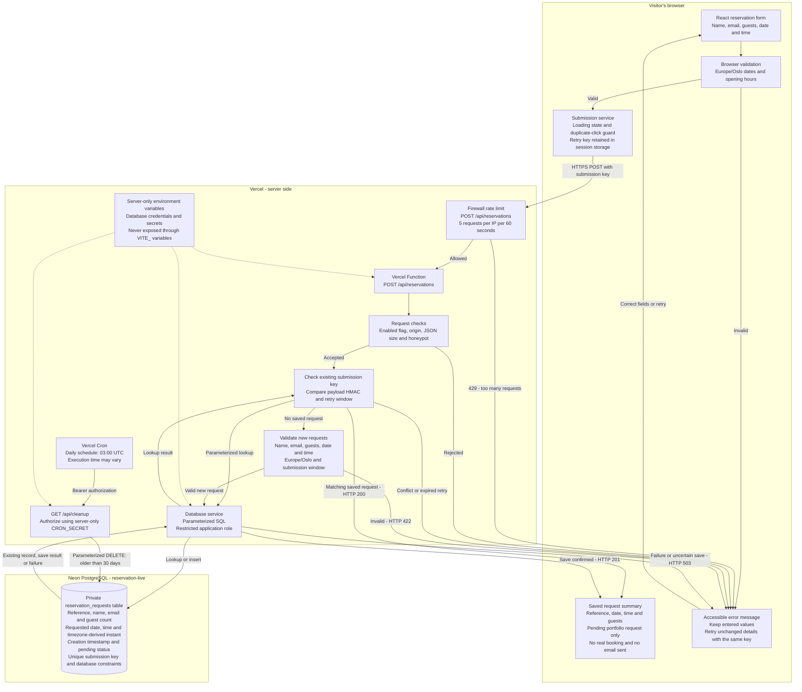

# Kofee — Fullstack Coffee Shop Portfolio

A responsive coffee shop website with a working reservation-request flow: a React form sends validated requests to a TypeScript API, which saves them in PostgreSQL and returns a reference.

**[Visit the live project](https://kofee-portfolio.vercel.app)**

This is a portfolio project for a fictional café. Requests are saved with **pending** status; no real table is booked, availability is not checked, and no email is sent. Use synthetic contact details when trying the form, such as `visitor@example.com`.

## Features

- Responsive coffee shop sections, menu, opening hours, footer and mobile navigation.
- Section anchors, smooth scrolling and entrance animations that respect reduced-motion preferences.
- Keyboard-operable reservation form with visible labels, accessible errors and confirmation announcements.
- Loading state and duplicate-click prevention; entered values are preserved after submission failures.
- Browser and server validation for contact details, 1–8 guests, valid dates and opening-hour time slots.
- Dates within the next 90 days, in 30-minute intervals; past dates and elapsed times today are rejected using **Europe/Oslo**.
- Database-backed request references and safe retries using a unique submission key.

## Technology

| Layer | Tools |
| --- | --- |
| Frontend | React, TypeScript, Vite, Tailwind CSS, React Icons |
| Backend | TypeScript Vercel Functions, Neon serverless driver |
| Database | Neon PostgreSQL |
| Hosting | Vercel Hobby; Neon Free |
| Checks | TypeScript, ESLint, Node test runner with `tsx` |

The frontend, API routes and shared validation live in `Coffee_Shop_Site/`. Form presentation, HTTP submission, server request handling and database access are separate modules.

## System architecture

The diagram shows the published system. Local development and integration tests use a separate `reservation-test` branch, while production uses `reservation-live`.



Diagram source: [docs/system-architecture.mmd](docs/system-architecture.mmd). Keep the source and this embedded copy in sync when the system changes.

### Reservation lifecycle

1. The browser validates the fields and creates a submission key. Session storage retains retry metadata, not the raw name or email.
2. The API checks the request and looks for an existing submission. An unchanged retry returns the existing reference; conflicting reuse is rejected.
3. New requests undergo server validation before a parameterized insert. A unique database constraint prevents concurrent retries from creating duplicate rows.
4. Only a verified saved response produces the pending confirmation. A failed or uncertain response preserves the form values so the visitor can retry the same request.

Selecting **Make another request** intentionally starts a new request. Duplicate protection applies to retries of the same submission, not every reservation with similar details.

### Data and safeguards

- Stored data includes a generated reference, name, email, guest count, requested calendar date/time, timezone-derived timestamp, creation timestamp and pending status, plus submission-key and HMAC metadata for retry checks.
- Calendar inputs are interpreted in `Europe/Oslo`. PostgreSQL converts the requested date/time to a `timestamptz` instant using that timezone, including daylight-saving changes.
- The application database role can insert requests and read reservation/retry metadata. It cannot select names or emails or update records. Its delete permission supports cleanup.
- There are no public endpoints for listing requests or retrieving visitor contact information.
- Credentials and secrets remain server-side. They are never supplied through `VITE_` variables or committed to Git.
- API checks include a 4 KB JSON limit, origin checks, a honeypot and an environment-based submission switch. The production firewall is configured for 5 reservation POST requests per IP per 60 seconds. These measures reduce abuse but do not guarantee availability or prevent distributed attacks.
- A protected daily cron route deletes records older than 30 days on the next successful cleanup. The schedule is 03:00 UTC; execution can vary. Database recovery history may temporarily retain deleted data.

No email service, customer accounts, admin interface, payments or automatic table allocation are implemented.

## Run locally

Use **Node 22.20.0** locally. The repository includes an `.nvmrc`; Vercel runs Node 22.x.

```sh
git clone https://github.com/hltnina31/Coffee_Shop.git
cd Coffee_Shop/Coffee_Shop_Site
nvm use
npm ci
```

### Frontend only

```sh
npm run dev
```

This starts Vite for frontend development. It does not start the reservation API. `npm run preview` also serves the frontend build only.

### Frontend and backend

For a fresh setup, create ignored `.env.local` and `.env.test.local` files inside `Coffee_Shop_Site/`, using [`.env.example`](Coffee_Shop_Site/.env.example) as a reference. Do not overwrite existing credentials or share their contents.

Prepare a dedicated Neon test branch and apply [the SQL schema](Coffee_Shop_Site/db/001_reservation_requests.sql) once using its owner connection. Set a private password for the SQL-created `reservation_app` role separately. Do not use the owner connection as the app's runtime connection.

| File | Variable | Local value or purpose |
| --- | --- | --- |
| `.env.local` | `DATABASE_URL` | `reservation_app` connection to the test branch |
| `.env.local` | `RESERVATION_HASH_SECRET` | Random private secret of at least 32 characters; keep stable for retries |
| `.env.local` | `ALLOWED_ORIGIN` | `http://localhost:3000` |
| `.env.local` | `RESERVATIONS_ENABLED` | `true` to enable local submissions |
| `.env.test.local` | `TEST_DATABASE_URL` | Exactly the same app connection as local `DATABASE_URL` |
| `.env.test.local` | `TEST_DATABASE_OWNER_URL` | Owner connection to that same disposable branch; integration tests only |
| `.env.test.local` | `TEST_DATABASE_CONFIRM` | `disposable-test-branch` |

```sh
npm run dev:fullstack
```

Open **http://localhost:3000**. The local Vite middleware uses the same server validation and database service as the Vercel endpoint. It refuses to start if the runtime connection differs from `TEST_DATABASE_URL`. This is a development adapter, not an emulation of all Vercel features; it does not schedule cleanup or apply the production firewall.

## Checks and testing

Run these commands from `Coffee_Shop_Site/`:

| Command | Purpose |
| --- | --- |
| `npm run build` | Type-check the project and create the frontend production build |
| `npm run lint` | Run ESLint |
| `npm run typecheck` | Check frontend, backend, shared code and test types |
| `npm test` | Run 18 isolated validation, API, submission-service and form-state tests |
| `npm run test:integration` | Test real PostgreSQL inserts, constraints, concurrent retries, timezone conversion, permissions and retention |
| `npm run preview` | Serve the frontend production build locally |

**Integration tests write and delete synthetic records and run retention cleanup. Use only a disposable test branch, never `reservation-live`.** They require the test environment values above; missing configuration skips the database test rather than verifying a save.

Build, lint, type checks and isolated tests passed during implementation. Real Neon integration tests passed on the test branch. The compiled backend was also checked with native Node execution after correcting ESM import paths.

Production checks verified server-side rejection of invalid requests and rejection of unauthorized cleanup calls. Manual form testing and live database inspection confirmed saved pending requests and matching references/details; the project owner also reported successful manual testing of failure recovery and retries. Automated browser rendering was unavailable in the development environment. A scheduled production cleanup run has not been independently observed as part of these checks.

The latest dependency audit reported no production dependency vulnerabilities; development tooling still has outstanding audit findings. These should be reviewed before future tooling changes. This is a snapshot of checks performed, not a guarantee about future dependency reports.

## Deployment configuration

The project is connected to GitHub for automatic Vercel deployments. For a repository import, use:

| Setting | Value |
| --- | --- |
| Root Directory | `Coffee_Shop_Site` |
| Framework | Vite |
| Node | 22.x |
| Install | `npm ci` |
| Build | `npm run build` |
| Output | `dist` |
| Functions region | Frankfurt (`fra1`) |

Configure `DATABASE_URL`, `RESERVATION_HASH_SECRET`, `CRON_SECRET`, `ALLOWED_ORIGIN` and `RESERVATIONS_ENABLED` as **Production-only** server environment variables. `ALLOWED_ORIGIN` must match the public HTTPS origin without a trailing slash. Production uses the restricted role on `reservation-live`; preview deployments must not receive live database credentials. Both secrets must contain at least 32 characters. Vercel sends `CRON_SECRET` as bearer authorization to the cleanup function.

The daily cron schedule is defined in [`vercel.json`](Coffee_Shop_Site/vercel.json). The firewall rule is configured separately in the Vercel dashboard. Production configuration is not supplied by the local environment files. Monitor Vercel and Neon usage to stay within their free-plan allowances.

## Project structure

```text
Coffee_Shop_Site/
├── api/                 # Vercel reservation and cleanup endpoints
├── db/                  # PostgreSQL schema and role permissions
├── server/              # Server validation, retry handling and SQL access
├── shared/              # Types, opening hours and Oslo-aware validation
├── src/
│   ├── assets/          # Coffee shop images and icons
│   ├── components/      # Page sections and reservation form
│   ├── data/            # Shared page content
│   ├── hooks/           # Entrance animations
│   ├── services/        # Browser submission and retry metadata
│   └── utils/           # Shared validation re-exports
└── tests/               # Isolated tests and Neon integration tests
docs/
└── system-architecture.mmd
```
